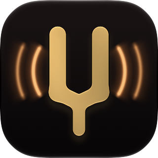
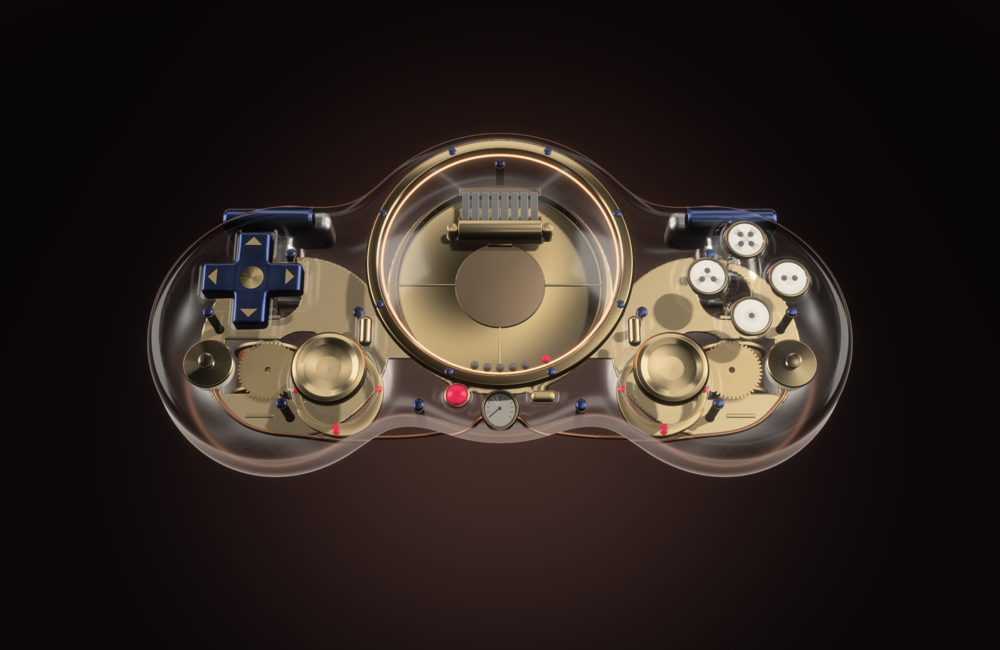
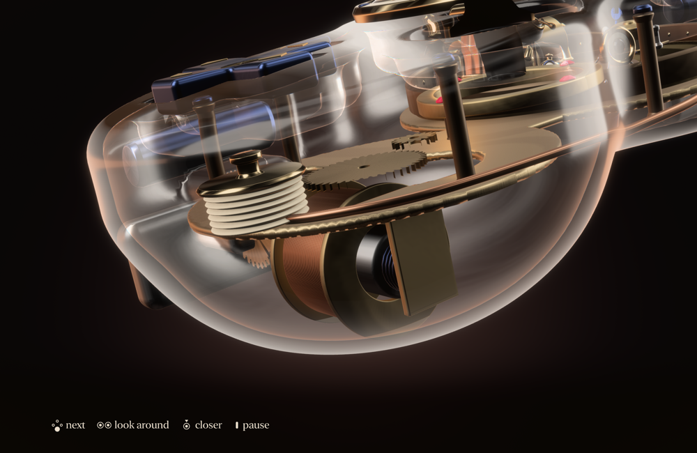
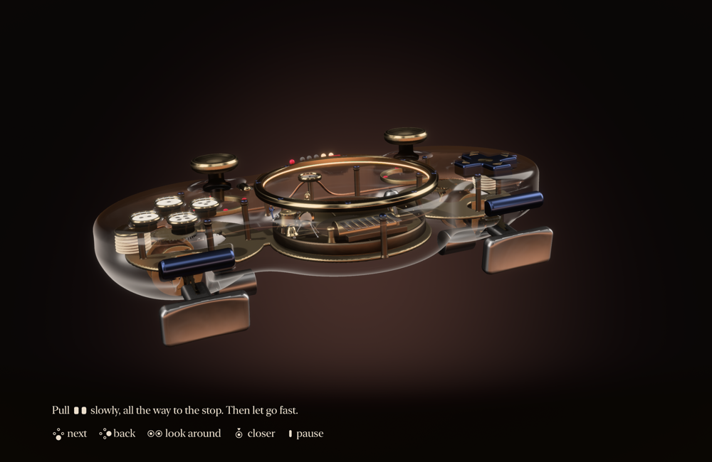
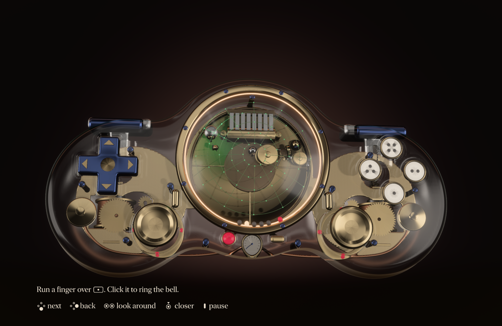
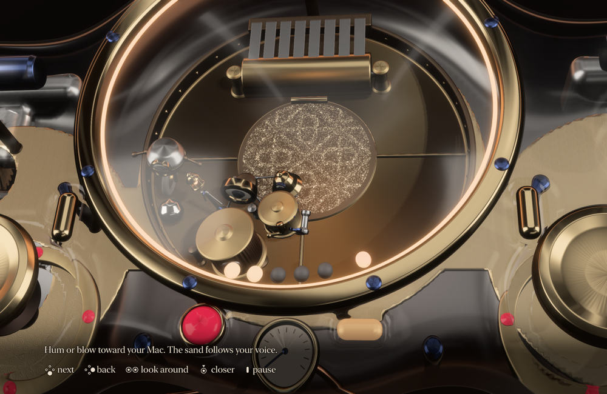

<p align="center">
  
</p>

<h1 align="center">Handsong</h1>

<p align="center"><b>Feel your Mac's music in your hands.</b></p>

<p align="center">
  Whatever your Mac plays, felt through a DualSense controller over Bluetooth.<br>
  No driver, no Terminal. And a five-minute tour of an instrument you hold.
</p>

<p align="center">
  <a href="https://github.com/erhansavas/Handsong/actions/workflows/ci.yml"></a>
  <a href="https://github.com/erhansavas/Handsong/releases/latest"></a>
  <a href="LICENSE"></a>
  
</p>

<p align="center">
  
</p>

## Why you might want it

macOS treats the DualSense as a plain gamepad. Handsong gets the rest out of it, with one app and nothing else to install.

- **Music you can feel.** Spotify, YouTube, a film: whatever your Mac plays reaches your hands. Speech and silence stay out of it, and there is nothing to tune.
- **It stays out of the way.** It lives in the menu bar, and you can close its window. When a game is in front it lets go of the controller at once, and comes back when you leave.
- **Something worth showing a friend.** A five-minute tour of what this controller can really do, and all of it original.

## What's inside

| | |
|---|---|
| **Feel it** | Your Mac's sound in your hands, in the background, all day |
| **Full Feel** | The same at full strength, full screen, with the instrument showing what your music is doing |
| **The tour** | An opening, six short chapters and a finale, about five minutes |
| **Free Play** | The tour's last room, also a click away: every control is alive, and no single press sends you away |
| **Check your controller** | Sticks, triggers, touch and every key, live |
| **Speaker** (experimental) | Your Mac's sound from the controller's own speaker. Rough for now: see [limits](#honest-limits) |

## A look around

<table>
  <tr>
    <td><br><b>Coils.</b> A beat in one hand, and the magnet on that side jumps.</td>
    <td><br><b>Triggers.</b> Pull to the firmware's limit, gear for gear, into a real stop.</td>
  </tr>
  <tr>
    <td><br><b>Touch.</b> The wire wakes green under your finger, and the controller's light goes with it.</td>
    <td><br><b>Breath.</b> Hum or blow, and the sand finds its figure. Nothing is recorded.</td>
  </tr>
</table>

<sub>Real frames from the app, rendered with scripted input. Video cannot show what the hands get, and neither can a picture.</sub>

## Install

1. Download `Handsong.dmg` from [Releases](https://github.com/erhansavas/Handsong/releases/latest), open it and drag Handsong to Applications.
2. Open it. macOS refuses the first time, because this free student project has no paid Apple Developer ID. Go to **System Settings > Privacy & Security**, scroll down and choose **Open Anyway**, once.
3. Turn on your controller. If it has never been paired, the app shows you how.

That is all: no Terminal, no driver, no administrator rights. Permissions are asked for only when they mean something. Feel it and the speaker need to hear your Mac's sound; say no and the tour still works. The microphone opens only while the Breath chapter is listening, and nothing is ever recorded.

**To remove it:** Settings, then Remove. Everything it added goes with it.

## Controls

The line at the bottom of the screen always says what the keys do right now.

| | In the tour | In Free Play |
|---|---|---|
| **Lower key** | next | a note |
| **Right key** | back | a note; **hold to leave** |
| **Left and top keys** | what the chapter says | notes |
| **Triggers** | what the chapter says | gears, the stop and steam |
| **Touch surface** | what the chapter says | hold and slide to strum |
| **Sticks** | look around; press to go closer | the same |
| **Options** | pause | pause |

On the Mac: **Esc** pauses, **Command-Tab** gives you your desktop back and the story waits, **Command-Q** asks first. With no controller, the arrow keys and the mouse still move through the story.

## Honest limits

- **Tested on one Mac only:** a MacBook Air M4 with an LCD panel, on macOS 27.2. Every Apple silicon Mac from macOS 15 is built for, and it measures your GPU and sizes the picture to hold 60 frames a second, but nobody has run it elsewhere yet. Your report would really help.
- **Strongest in full screen.** A full stream to the hands needs more than Bluetooth gives a Mac until Game Mode widens the link, and macOS only does that for an app filling the screen. In the background the feel is softer, and the app says so.
- **The speaker has a known fault.** Measured with a microphone, a pure tone leaves the controller impure while the data sent decodes cleanly. The cause has not been found.
- **Physics and firmware.** The actuators answer about 110 ms after they are told, the speaker and full haptics cannot run together, and the triggers stop at the firmware's limit.
- **Feel cannot be measured.** The numbers below say the signal is clean. Only your hands can say the rest.

## Build from source

Needs Xcode 26 or later, [`uv`](https://docs.astral.sh/uv/) and Blender 5.2.

```sh
tools/build_assets.sh   # the model, the score and the icon, from nothing: about a minute
./build.sh              # build/Handsong.app
test/run_gates.sh       # every check, with results in docs/evidence
```

`tools/sign_notarize_package.sh` signs and notarises with your own Developer ID, if you have one.

## Reporting problems

Please [open an issue](https://github.com/erhansavas/Handsong/issues) with your Mac model, your display and what you saw. For anything about feel, say what was playing.

<details>
<summary><b>Measurements</b></summary>

From the gates on one machine: MacBook Air, Apple M4 with 8-core GPU, LCD, macOS 27.2.

| What | Result | Limit |
|---|---|---|
| Frames, native 2560 x 1664, a five-minute tour | 19,155 frames, 0 skipped in the last runs (see below), Game Mode on | 0 skipped |
| GPU per frame, heaviest chapter at full clock | 8.20 to 8.21 ms of 16.67 | 8.2 ms: on the line |
| First frame after launch, pipelines cached | 63 ms | 300 ms |
| Asking for the picture to its first image | 778 ms | 1000 ms |
| Whole tour loudness, true peak | -19.9 LUFS, -2.50 dBTP | -20 +/-1.5, -2 |
| Press to sound, direct | mean 22.7, worst 24.8 ms | 26, 32 ms |
| Listening, eleven kinds of material | no limiting, true silence after each, speech at 18% of music | 0.1%, 0, 20% |
| Microphone in a real room, silent | moved in 3 of 319 buffers, at most 7% | almost nothing |
| Memory | 295 MB | 900 MB |

**Missed:** against a 16x supersampled reference, the strict image targets are not met. Edge error (FLIP, typical view) is 0.35 against 0.317, and flickering pixels run 1.4 to 2.0 times the reference against 1.3. The strongest fix tried doubled the GPU time and still did not close them.

**Seen and unexplained:** some full test runs show one or two frames of around 100 ms, at no fixed moment and away from the app's main thread, and one GPU sample in the opening has read 6.5 ms against its 6.4 ms limit. Neither appeared in every run.

</details>

<details>
<summary><b>How it works</b></summary>

One bundle, one process, one writer on the controller's link. A small helper only ever acts if the app dies, to let go of the triggers and hand the Sound output back.

- `src/link` the controller: reports as plain bytes, a state machine, and the IOKit path.
- `src/listen` from the Mac's sound to the hands and the speaker.
- `src/motion` from the sensors to a pose that never jumps.
- `src/render` the picture: forward at 4x on tile memory, at the panel's native pixels, Display P3, nothing temporal.
- `src/world` the crew's hall, simulated with Jolt under the forces the real controller feels.
- `src/experience` the director and its chapters. `src/sound`, `src/hands` the mix and what the hands get.
- `src/app` menu, Home window, care. `model/instrument`, `sound/compose.py` make every asset from nothing.
- [`docs/PROTOCOL_NOTES.md`](docs/PROTOCOL_NOTES.md) the facts the controller code rests on, with their sources.

**Displays.** The picture stays in standard range everywhere, so it looks the same on every panel. A backlit LCD shows a blue-grey glow in dark pictures, so on those panels the deepest shadows become a very dim warm room that the glow disappears into. Mini-LED displays reach real black and are left at it. Your display runs in its native pixels while the picture is up, and goes back when you leave.

</details>

## License

[Apache-2.0](LICENSE), with [`NOTICE`](NOTICE). Every shipped asset is listed in [`docs/ASSETS.md`](docs/ASSETS.md) with its origin. Third-party code keeps its own licence under `third_party/`: Jolt Physics and GamepadMotionHelpers (MIT), libopus (BSD 3-Clause). The asset scripts that drive Blender are Apache-2.0, which is compatible with the GPLv3 that Blender's scripting interface requires of them. This is engineering care and not legal advice.

Handsong works with the Sony DualSense wireless controller. It is an independent project, not affiliated with or endorsed by Sony. All trademarks belong to their owners.
